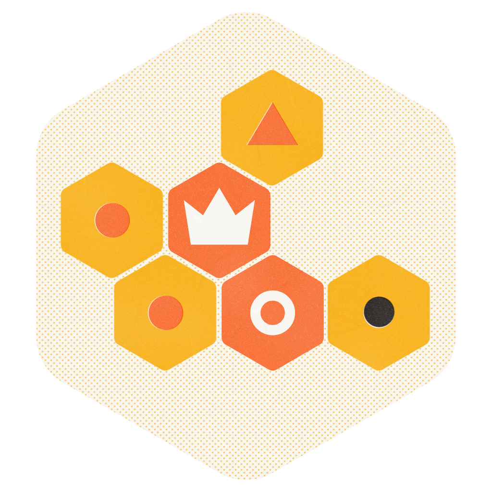
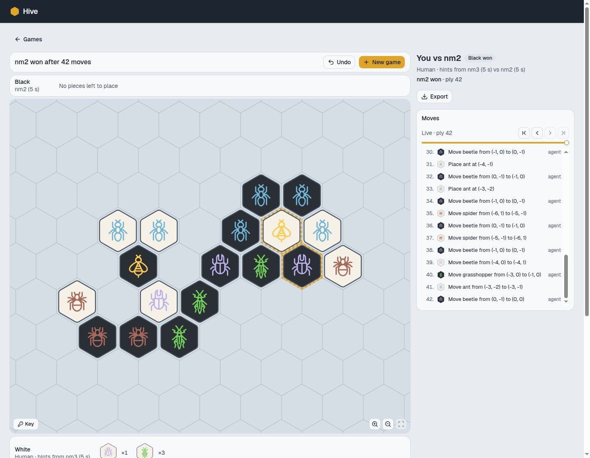

# Hive

Hive is a two-player board game in which players place and move insect tiles to surround their opponent's queen. There is no fixed board. The tiles form a connected hive, and each insect moves differently. This project combines a Python rules engine, search-based agents, and a web app for playing games and inspecting moves. Tests and timed matches support work on engine correctness and comparisons between agents.



*An existing game against the nm2 agent, shown in the local web app.*

## Background

The engine provides the rules shared by the web app and the agents, so legal moves, game history, and search all use the same representation. The command-line tools make it possible to compare agents under a fixed time budget without running the app. The browser adds a board for playing against an agent, following a physical game with hints, or watching two agents play.

## Getting started

Use Python 3.13 and [uv](https://docs.astral.sh/uv/). The web app also needs Node.js 24 or newer, npm, and Docker with Compose for its local PostgreSQL and Garage services. Run the commands below from the repository root.

### Play in the browser

```sh
make sync
make dev
```

Open `http://localhost:5173` and choose **New game**. You can play against an agent on screen, play a friend at the table with hints, or watch two agents. To make a manual move, select a tile in your hand or on the board, then select a highlighted target. The move list and replay controls let you revisit earlier positions without changing the game.

`make dev` creates `.env` from `.env.example` if needed, starts the local services, applies database migrations, and runs the API on port 8000 alongside Vite on port 5173. The example credentials are for local development only. Stop the app with Ctrl+C, then run `make dev-down` to stop its services without deleting their data.

See [local development](docs/local-development.md) for configuration, serving a frontend build, and API documentation.

### Work on the engine

The engine and command-line matches do not need Node.js, Docker, or a database.

```sh
uv sync
uv run hive --version
uv run hive bench perft --depth 4
uv run hive play --white nm2 --black random --budget 0.1 --max-turns 10
```

Perft counts the legal move tree and checks the result against a stored reference when one is available. The match command logs each decision and stops when the game ends or either player reaches the turn cap. Here, `--budget` is the time allowed per decision in seconds and `--max-turns` is the cap per player.

## How it works

The base game includes queens, beetles, grasshoppers, spiders, and ants. `Rules` owns the rule configuration and validates moves at the public boundary. Search uses reversible state updates to explore positions without repeating that validation at every node. Unit tests, property tests, and [perft reference counts](tests/data/perft/README.md) check the engine's behavior.

Random, minimax, and negamax agents share a timed decision interface. The search agents use iterative deepening and submit candidate moves as they work. Persistent worker processes keep agent computation separate from the runner, which uses the latest legal candidate when the time budget expires. YAML presets such as `nm2` and `nm3` configure the same agents used by both the app and the CLI.

The React and TypeScript frontend renders an SVG board and uses a typed client generated from the FastAPI schema. PostgreSQL stores games and moves, while agent thinking updates stream to the browser through server-sent events. Table games support hints and confirmation of pending agent moves. Garage provides the S3-compatible object store used by the API's storage layer.

## Compare agents

Run a two-game comparison with colors reversed, keep the moves, and replay one match as SVG boards.

```sh
uv sync --extra plotting
uv run hive gauntlet --agent nm2 --agent random --games-per-pair 2 \
  --budget 0.1 --max-turns 10 --jobs 1 --replays --out gauntlet.json
uv run hive replay gauntlet.json --match 0 --plot-dir boards
```

The JSON report contains match outcomes and decision statistics, including timing and worker failures. These short, turn-capped matches are useful for checking the workflow, not for establishing playing strength. Increase the game count and turn cap for comparisons, and avoid oversubscribing CPUs when measuring agents under a time budget. Use `uv run hive gauntlet --help` to see the available options.

## Current scope

The web app is implemented, with manual move entry, agent turns, hints, game management, replay, and in-app help and rules. Camera-based move entry, board recognition, synthetic training data, and a 2.5D renderer remain planned work. The repository currently provides local development services, not the full deployment described in the project plan.

Only the base-game insects are implemented. Expansion pieces and stronger search techniques such as alpha-beta pruning and transposition tables are future work. The [project plan](docs/plans/README.md) describes the intended direction, including features that are not yet available.

## Development

`make sync` installs all Python extras, development tools, and frontend dependencies. The main checks are shared with CI.

```sh
make check          # format, lint, and type-check Python and frontend code
make test           # Python tests with coverage, then frontend tests
make test-slow      # longer-running Python tests
make api-client     # regenerate frontend types from the API schema
make install-hooks  # install pre-commit and commit-message hooks
```

`make check` can modify source files through formatting and lint fixes. API integration tests start a temporary PostgreSQL container, so Docker must be available for full coverage. Outside CI, tests that need the database are skipped if Docker is unavailable. Frontend tests use jsdom and mocked API responses, so they do not replace exercising the running app.

The [design notes](docs/plans/README.md) cover the [engine](docs/plans/engine.md), [agents and matches](docs/plans/agents-and-matches.md), [API and data](docs/plans/api-and-data.md), and [frontend](docs/plans/frontend.md). Treat their roadmap sections as plans rather than a list of shipped features.
