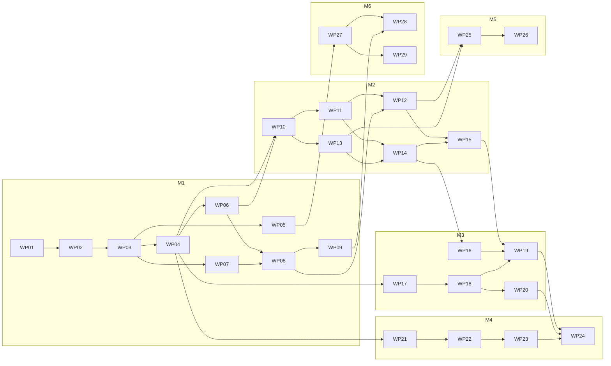

# Hive project plan

This folder is the main context for the project. Every implementation session starts here.
It describes what we are building, why, the decisions made, the target repo structure, and
the order in which work happens. Topic files go deeper on each area:

| File | Covers |
|---|---|
| [`engine.md`](engine.md) | Engine design, `Rules`, validated entry points, invariants |
| [`perft.md`](perft.md) | Perft correctness and speed harness, reference data |
| [`agents-and-matches.md`](agents-and-matches.md) | Agent interface, timed workers, match runner, gauntlets, observability |
| [`api-and-data.md`](api-and-data.md) | FastAPI service, Postgres schema, Garage storage, endpoints |
| [`frontend.md`](frontend.md) | React app, components, board renderers, game flows |
| [`vision.md`](vision.md) | Board readers, grid fitting, move matching, evaluation |
| [`synthetic-data.md`](synthetic-data.md) | Scene generation, Blender tilesets, rendering, datasets, YOLO training |
| [`tooling.md`](tooling.md) | Code style, ruff/ty/pytest, Makefile, Claude Code hooks, CI |
| [`deployment.md`](deployment.md) | Docker image, Kubernetes manifests, Argo CD, Tailscale, homelab prerequisites |
| [`performance.md`](performance.md) | Engine speed and agent strength round (profiling, autoresearch, Rust) |

Work is split into **work packages** (WPs), each tracked as a GitHub issue that contains a
self-contained session prompt. The entry point for a session is: *"Implement issue #N"*.

---

## 1. Vision

A Python Hive engine with strong agents, exposed through a web app that runs on a homelab
Kubernetes cluster behind Tailscale. At the table, the app tracks a physical game:

- Each side is either a **human** or an **agent**. Supported setups are human vs agent
  (play against the agent, or follow the agent's advice against a friend) and agent vs
  agent (watch a match). Human vs human is not a goal.
- Human moves are entered **manually** (tap a tile, tap a target) or with the **camera**:
  a photo is taken, tiles are detected, and the engine infers which legal move was played.
- Agent moves are computed within a fixed **time budget**, with the search streamed live to
  the UI, then executed on the physical board by a person.
- Utilities: which tiles can move, legal targets for a tile, replay and manage past games.

Supporting tracks:

- **Offline evaluation**: a CLI runs fair, timed gauntlets between parameterized agents.
- **Vision**: a classical CV reader and a YOLO reader behind one interface, compared on
  tile-, board- and game-level metrics plus latency.
- **Synthetic data**: Blender renders random valid boards (generated by the engine) with
  interchangeable physical tilesets to train the YOLO detector.

## 2. Scope and non-goals

In scope for the milestones in this plan:

- Base game only: queen, beetle, grasshopper, spider, ant.
- Search agents (random, minimax, negamax, later alpha-beta with a transposition table).
- Photo tracking from a known starting position (one legal move per photo, two-move
  recovery), with manual fallback.
- Synthetic-only training data for YOLO. Real photos are captured and stored by the app,
  and used for evaluation only.

Explicitly out of scope for now (documented under [Future work](#10-future-work)):

- Expansion pieces (mosquito, ladybug, pillbug). The `PieceType` enum and `Rules` stay
  open to extension.
- Reinforcement-learning or neural-network agents. The abstractions must not block them:
  `AgentSpec` params are free-form (for example a weights path), workers are persistent so
  heavy models load once, and inference can use ONNX like the vision model.
- Reading a full mid-game position from a single photo. A manual board editor covers
  starting from a known mid-game position.
- Training on real photos and a labeling pipeline. The schema already stores everything
  needed to add this later.
- Human vs human games, pondering, cluster-side gauntlet/render/training jobs, a 3D board
  renderer (the renderer interface allows adding one later), UHP notation export.

## 3. Architecture overview

```
                       ┌──────────────────────── hive (single Python package) ───────────────────────┐
                       │                                                                             │
 phone browser ──HTTPS─┼─▶ api (FastAPI) ──▶ engine (GameState, Rules)                               │
 (React SPA,           │      │   │              ▲                                                   │
  served by FastAPI)   │      │   └──▶ match (worker pool, timed decisions) ──▶ agents (search)      │
                       │      │                                                                      │
                       │      ├──▶ vision (BoardReader → grid fit → move matcher) ──▶ engine         │
                       │      ├──▶ Postgres (games, moves, photos)                                   │
                       │      └──▶ Garage S3 (photos, models)                                        │
                       │                                                                             │
 CLI ──────────────────┼─▶ hive gauntlet | bench perft | data scenes | vision eval | serve           │
                       └─────────────────────────────────────────────────────────────────────────────┘

 offline (workstation, NVIDIA GPU):
   hive data scenes ──JSON──▶ blender -b -P blender/render.py ──▶ images + YOLO labels
        ──▶ scripts/train (Ultralytics) ──▶ model.onnx ──▶ Garage ──▶ api YoloReader
```

Dependency direction inside the package is strictly one way:
`engine ← agents ← match ← api`, `engine ← vision ← api`, `engine ← data`. The engine
imports nothing from the rest of the package.

## 4. Decisions

Each decision has a short rationale. Topic files go into detail.

| # | Decision | Rationale |
|---|---|---|
| D1 | Merge `hive-engine` and `hive-agents` (and drop `services/hive-api`) into one package `hive` with one `pyproject.toml` and one `uv.lock`. Heavy deps behind extras: `api`, `vision`, `train`. | The split added per-package locks, Makefiles and venvs with no benefit; agents are a thin layer over the engine. |
| D2 | Replace `Ruleset` and the four rule ABCs with one frozen `Rules` dataclass holding config and rule methods. | Every ABC has exactly one implementation; real variation is constructor params. A frozen value is hashable, cheap to pass to workers and to store. |
| D3 | Behaviour is a method on the type that owns the data it reads. Plain functions only for math on primitives without an owning type (`grid.py`). | One consistent rule. `Rules` is an immutable value, so its methods are as testable as functions. |
| D4 | Validate at the boundary, trust inside: `GameState` is created only via `Rules.create_initial_state`, `Rules.from_board` (validated) or advanced via `Rules.apply_checked_move` (validated). Search uses unchecked `apply_move` / `undo_move`. | Correctness without paying validation cost in search. Perft and property tests guard the fast path. |
| D5 | Correctness first: perft parity against published reference counts (stored as cited data in the repo, no dependency on other engines). Speed is a separate later round. | Perft catches rule bugs hand-written tests miss, and doubles as a speed benchmark. |
| D6 | Engine speed round goes profiling → autoresearch → Rust rewrite, each only if the previous is not enough. | Keep the engine readable until data shows otherwise. |
| D7 | Agents implement `think(state, turn)` and talk through a `TurnContext` with `submit(move, final=...)`, `remaining_seconds()`, `should_stop()` and `info(...)`, adapted from the `shed` project. | Iterative-deepening style anytime decisions; the runner caps turn time in the app and keeps gauntlets fair. |
| D8 | One persistent worker process per seat per match (per pool slot in the API). Cooperative stop via a shared event. The runner takes the latest legal candidate at the deadline; a worker is only killed if it misses a grace period. | Mirrors UCI chess engines. Models and caches load once; kills are a safety net, not the normal path. |
| D9 | Same `AgentSpec(kind, params)` + factory drives the API agent picker and the gauntlet CLI. | One way to name and configure agents everywhere. |
| D10 | Stateful backend: Postgres stores games, moves, photos; Garage (S3) stores photo bytes, datasets and models. The engine stays stateless per request: load moves, replay, answer. | Game management and replay in the UI; pods can restart freely. |
| D11 | Moves stored as JSON mirroring the engine `Move`. | Simple and exact. UHP notation can be added as an export later. |
| D12 | Photo tracking: each photo is matched against the boards produced by all legal moves (plus two-move sequences as recovery). | Hidden stack contents are known from history; detection noise is corrected by legality. |
| D13 | Two vision readers behind one `BoardReader` protocol: classical CV first, YOLO second. Shared grid fitting and matching. | The classical reader needs no training data, unblocks the app early, and is the baseline YOLO must beat. |
| D14 | YOLO trained with Ultralytics, exported to ONNX, served with ONNX Runtime. | Keeps torch out of the API image. |
| D15 | Blender is decoupled from the package: `hive data scenes` writes scene JSON, `blender/render.py` (Blender's bundled Python) reads it. | Blender bundles its own Python version; the package requires 3.13. |
| D16 | Tilesets are folders under `blender/tilesets/<id>/` with a `tileset.toml` manifest and one file per tile; the renderer picks one per image. Assets in Git LFS. Detection classes are tileset-agnostic. | Adding a physical set is adding a folder; per-tileset evaluation via metadata. |
| D17 | Frontend: Vite + React + TypeScript, Tailwind + shadcn/ui, TanStack Query, OpenAPI-generated client, built files served by FastAPI. Board rendering behind a renderer interface (SVG first). | One origin, typed API, consistent reusable components, swappable 2D/3D rendering. |
| D18 | Agent thinking streams to the UI via server-sent events. | Live "depth 3: Ant → (2,-1)" refinement, simple to implement. |
| D19 | Deploy: GitHub Actions → GHCR → Argo CD (pull) → homelab cluster; Tailscale operator for HTTPS ingress; CloudNativePG; SOPS secrets; Prometheus/Grafana/Loki. App manifests live in this repo (`deploy/`), CI commits image tag bumps. Cluster platform lives in a separate homelab repo. | GitOps with audit trail and `git revert` rollbacks; no cluster credentials in CI. |
| D20 | Offline compute (gauntlets, rendering, training) runs locally on the workstation GPU; artifacts go to Garage. | Keeps the deploy milestone focused on the app. |
| D21 | Google-style docstrings, types everywhere (tests included), 90 character lines, automatic formatting including docstring prose and comments, Claude Code hook formats after every edit. | See `tooling.md`. |

## 5. Target repo structure

```
hive/
├─ pyproject.toml              # single package `hive`, extras: api, vision, train; ruff/ty/pytest config
├─ uv.lock                     # committed
├─ Makefile                    # all developer commands (see tooling.md)
├─ CLAUDE.md                   # agent instructions, points to docs/plans
├─ .claude/
│  ├─ settings.json            # hooks: format after edit, check on stop
│  └─ hooks/                   # hook scripts
├─ .github/workflows/          # ci.yaml (checks), release.yaml (image + tag bump)
├─ docs/plans/                 # this folder
├─ src/hive/
│  ├─ engine/                  # grid.py, state.py, rules.py, serialization.py, errors.py
│  ├─ agents/                  # base.py, factory.py, random.py, minimax.py, negamax.py, evaluators/
│  ├─ match/                   # turn.py, worker.py, runner.py, records.py, gauntlet.py
│  ├─ vision/                  # [vision] reader.py, classical/, yolo/, grid_fit.py, matcher.py, eval/
│  ├─ data/                    # scenes.py (scene JSON), datasets.py (manifests, export)
│  ├─ api/                     # [api] app.py, settings.py, db/, storage.py, routes/, pool.py, metrics.py
│  ├─ plotting/                # existing matplotlib/svg plotting (optional extra `plotting`)
│  ├─ assets/                  # insect SVG/PNG assets
│  ├─ bench.py                 # perft and benchmarks
│  └─ cli.py                   # `hive` entry point (Typer)
├─ tests/                      # mirrors src/hive/; tests/data/ holds perft references and fixtures
├─ scripts/
│  ├─ train/                   # [train] YOLO training and ONNX export
│  └─ tooling/                 # comment checker used by `make lint`
├─ blender/
│  ├─ render.py                # runs under Blender's Python, no `hive` import
│  └─ tilesets/<tileset-id>/   # tileset.toml, one .blend per tile, textures/ (Git LFS)
├─ frontend/                   # Vite + React + TypeScript app
└─ deploy/
   ├─ Dockerfile
   ├─ compose.yaml             # local Postgres + Garage for development
   ├─ base/                    # Kustomize base
   └─ overlays/homelab/        # image tag, resources, SOPS secrets
```

Removed during consolidation: `packages/`, `services/`, `.devcontainer/`, `.claude/ralph/`,
per-package Makefiles and lockfiles, the `notebooks/` folder (move anything worth keeping to
a test or a script first).

## 6. Milestones

| Milestone | Goal | Done when |
|---|---|---|
| **M1 Foundation** | Tooling, single package, `Rules`, validated entry points, perft parity, agent interface, timed runner, gauntlet CLI | `make check test` is green, perft matches references at the agreed depths, `hive gauntlet` runs a timed round robin and writes a report |
| **M2 App** | API, Postgres, Garage, frontend with game management, manual moves, agent turns with streaming, agent vs agent | A full game against an agent can be played and replayed in the browser with manual move entry |
| **M3 Classical vision** | Photo capture, grid fitting, move matching, classical reader, camera flow, evaluation harness | Camera button proposes the correct move on real photos; `hive vision eval` reports metrics for the classical reader |
| **M4 Synthetic data and YOLO** | Scene generation, Blender rendering with tilesets, dataset export, YOLO training, ONNX reader, comparison report | YOLO reader is selectable in the app and compared against the classical reader on the real test set |
| **M5 Deployment** | Docker image, CI release, Kustomize manifests, Argo CD, Tailscale ingress, migrations, metrics | Merging to `main` deploys to the homelab and the app is reachable at `https://hive.<tailnet>.ts.net` |
| **M6 Performance** | Profiling, engine speedups, alpha-beta/TT agents, evaluator tuning, autoresearch harness | Measurable perft speedup with parity intact; stronger agent confirmed by gauntlet |

M6 depends only on M1 (perft and gauntlet) and can be interleaved with M2–M5 at any time.

## 7. Work packages and implementation order

Each work package is one session and one PR. The GitHub issue is the source of truth for the
session prompt. Dependencies are set as GitHub "blocked by" relationships, so a blocked
issue should not be started.

| WP | Title | Milestone | Depends on | Issue |
|---|---|---|---|---|
| 01 | Consolidate into a single `hive` package with tooling baseline | M1 | – | #12 |
| 02 | Docstring and comment formatting, convert to Google style | M1 | 01 | #13 |
| 03 | Replace `Ruleset` with frozen `Rules` | M1 | 02 | #14 |
| 04 | Validated entry points and invariant property tests | M1 | 03 | #15 |
| 05 | Perft harness and reference parity | M1 | 03 | #16 |
| 06 | JSON serialization for moves, rules and game records | M1 | 04 | #17 |
| 07 | Timed agent interface and agent factory | M1 | 03 | #18 |
| 08 | Persistent workers and timed match runner | M1 | 06, 07 | #19 |
| 09 | Gauntlet CLI and reports | M1 | 08 | #20 |
| 10 | API foundation: settings, database, storage, game management | M2 | 04, 06 | #21 |
| 11 | API move flow: state, targets, play, undo, replay | M2 | 10 | #22 |
| 12 | API agent pool, thinking stream and observability | M2 | 08, 11 | #23 |
| 13 | Frontend foundation and game list | M2 | 10 | #24 |
| 14 | Game page: board renderer and manual moves | M2 | 11, 13 | #25 |
| 15 | Agent turns, agent vs agent, replay in the UI | M2 | 12, 14 | #26 |
| 16 | Photo capture and storage | M3 | 14 | #27 |
| 17 | Grid fitting and move matching | M3 | 04 | #28 |
| 18 | Classical board reader | M3 | 17 | #29 |
| 19 | Camera move flow in the app | M3 | 15, 16, 18 | #30 |
| 20 | Vision evaluation harness | M3 | 18 | #31 |
| 21 | Scene generation from random valid games | M4 | 04 | #32 |
| 22 | Blender renderer with tilesets | M4 | 21 | #33 |
| 23 | Dataset export and manifests | M4 | 22 | #34 |
| 24 | YOLO training, ONNX reader, comparison | M4 | 19, 20, 23 | #35 |
| 25 | Docker image and release workflow | M5 | 12, 13 | #36 |
| 26 | Kubernetes manifests, Argo CD and Tailscale | M5 | 25 | #37 |
| 27 | Engine profiling and targeted speedups | M6 | 05 | #38 |
| 28 | Alpha-beta, transposition table and evaluator tuning | M6 | 09, 27 | #39 |
| 29 | Autoresearch harness for engine speed | M6 | 27 | #40 |

Dependency graph (arrows mean "unblocks"):



Recommended order (a valid topological order following the milestones):
01, 02, 03, 04, 05, 06, 07, 08, 09, 10, 11, 12, 13, 14, 15, 16, 17, 18, 19, 20, 21, 22, 23,
24, 25, 26, then 27, 28, 29. M6 (27–29) can start any time after 05 and 09.

## 8. Session workflow

Every session follows the same workflow. The issue body repeats the specifics.

1. Read this README, then the topic files and code the issue points to.
2. Branch from `main` using `feature/`, `fix/` or `chore/` plus a short slug, for example
   `feature/wp08-match-runner`.
3. Implement test-first where practical. Keep `make check test` green.
4. Commit with conventional commits (enforced by commitizen), for example
   `feat(match): add persistent worker with cooperative stop`.
5. If a decision in `docs/plans` turns out wrong or incomplete, update the doc in the same
   PR and call it out in the PR description.
6. Open a PR whose description summarises the change, lists how it was verified, and
   contains `Closes #N` for the issue.

## 9. Manual tasks and prerequisites

Some work needs things only the project owner can provide:

| Needed by | Task |
|---|---|
| WP 18 | Flat, evenly lit photos of each tile face of the physical set (templates for the classical reader) and a first batch of real game photos. |
| WP 20 | A hand-labeled real test set (50–100 photos, split by game) and a few recorded games with one photo per turn. |
| WP 22 | The modeled tileset `pocket-edition-normal-001` (one file per tile). The renderer is built against a procedural placeholder tileset first, so this does not block WP 22. |
| WP 26 | Homelab platform in the homelab GitOps repo: Argo CD, Tailscale operator, CloudNativePG, Garage, kube-prometheus-stack, Loki, SOPS key. |

## 10. Future work

Not planned in any milestone, but the design keeps these possible:

- RL or neural-network agents (self-play training, ONNX inference in workers).
- Expansion pieces.
- Real-photo training data and a labeling pipeline (Label Studio or CVAT, plus
  pseudo-labels from confirmed app photos).
- Board setup from a single photo (pre-filling the board editor).
- 3D board renderer with React Three Fiber.
- Gauntlets, rendering and training as Kubernetes Jobs.
- UHP notation import/export, hint button on human turns, pondering.
- Rust engine core (see `performance.md`, only if profiling and autoresearch fall short).
