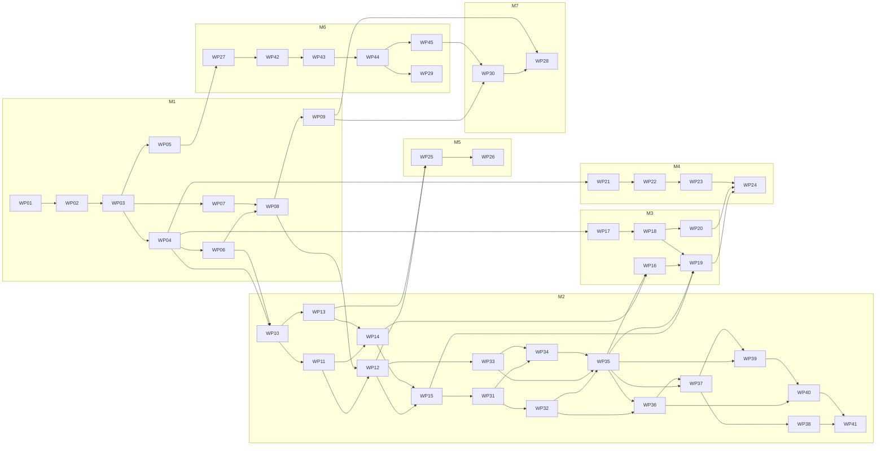

# Hive project plan

This folder is the main context for the project. Every implementation session starts here.
It describes what we are building, why, the decisions made, the target repo structure, and
the order in which work happens. Topic files go deeper on each area:

| File | Covers |
|---|---|
| [`engine.md`](engine.md) | Engine design, `Rules`, validated entry points, invariants |
| [`perft.md`](perft.md) | Perft correctness and speed harness, reference data |
| [`agents-and-matches.md`](agents-and-matches.md) | Agent interface, timed workers, match runner, gauntlets, observability |
| [`api-and-data.md`](api-and-data.md) | FastAPI service, Postgres schema, Garage storage, endpoints |
| [`frontend.md`](frontend.md) | React app, components, board renderers, game flows |
| [`vision.md`](vision.md) | Board readers, grid fitting, move matching, evaluation |
| [`synthetic-data.md`](synthetic-data.md) | Scene generation, Blender tilesets, rendering, datasets, YOLO training |
| [`tooling.md`](tooling.md) | Code style, ruff/ty/pytest, Makefile, Claude Code hooks, CI |
| [`deployment.md`](deployment.md) | Docker image, Kubernetes manifests, Argo CD, Tailscale, homelab prerequisites |
| [`evaluation.md`](evaluation.md) | Configurable evaluation, paired champion trials, tuning and promotion gates |
| [`performance.md`](performance.md) | Engine speed (M6: profiling, Rust core, autoresearch) and agent strength (M7: repetition, alpha-beta, tuning), with all measurements |
| [`rust-core.md`](rust-core.md) | Rust core of the engine and the search: crates, Python API contract, representation, search kernel, correctness gates |
| [`cleanup.md`](cleanup.md) | Cleanup round (WP 46 to 60): simpler abstractions, merged objects and the documentation restructure |

Work is split into **work packages** (WPs), each tracked as a GitHub issue that contains a
self-contained session prompt. The entry point for a session is: *"Implement issue #N"*.

---

## 1. Vision

A Python Hive engine with strong agents, exposed through a web app that runs on a homelab
Kubernetes cluster behind Tailscale. The app is the board on screen, or tracks a physical
game at the table:

- Each side is either a **human** or an **agent**, and a game is played **on screen** (the
  app is the board) or **at the table** (a physical board the app follows). Three
  scenarios are supported (D26): play against an agent (on screen), play a named friend
  with **hints** from an agent for you only (at the table), and watch two agents (on
  screen). Human vs human without hints is not a goal.
- Human moves are entered **manually** (tap a tile, tap a target) or with the **camera**:
  a photo is taken, tiles are detected, and the engine infers which legal move was played.
- Agent moves are computed within a fixed **time budget**, with the search streamed live to
  the UI. At the table a person then makes them on the physical board and confirms them.
- Utilities: which tiles can move, legal targets for a tile, replay and manage past games,
  a 2D and a 2.5D isometric board with animated moves, and in-app help with a rules
  reference.

Supporting tracks:

- **Offline evaluation**: a CLI runs fair, timed gauntlets between parameterized agents.
- **Vision**: a classical CV reader and a YOLO reader behind one interface, compared on
  tile-, board- and game-level metrics plus latency.
- **Synthetic data**: Blender renders random valid boards (generated by the engine) with
  interchangeable physical tilesets to train the YOLO detector.

## 2. Scope and non-goals

In scope for the milestones in this plan:

- Base game only: queen, beetle, grasshopper, spider, ant.
- Search agents (random, minimax, negamax, later alpha-beta with a transposition table).
- Photo tracking from a known starting position (one legal move per photo, two-move
  recovery), with manual fallback.
- Synthetic-only training data for YOLO. Real photos are captured and stored by the app,
  and used for evaluation only.

Explicitly out of scope for now (documented under [Future work](#10-future-work)):

- Expansion pieces (mosquito, ladybug, pillbug). The `PieceType` enum and `Rules` stay
  open to extension.
- Reinforcement-learning or neural-network agents. The abstractions must not block them:
  `AgentSpec` params are free-form (for example a weights path), workers are persistent so
  heavy models load once, and inference can use ONNX like the vision model.
- Reading a full mid-game position from a single photo. A manual board editor covers
  starting from a known mid-game position.
- Training on real photos and a labeling pipeline. The schema already stores everything
  needed to add this later.
- Human vs human games without hints, pass-and-play on one device, agent vs agent at the
  table, pondering, cluster-side gauntlet/render/training jobs, a free-orbit 3D board
  view, UHP notation export.

## 3. Architecture overview

```
                       ┌──────────────────────── hive (single Python package) ───────────────────────┐
                       │                                                                             │
 phone browser ──HTTPS─┼─▶ api (FastAPI) ──▶ engine (GameState, Rules)                               │
 (React SPA,           │      │   │              ▲                                                   │
  served by FastAPI)   │      │   └──▶ match (worker pool, timed decisions) ──▶ agents (search)      │
                       │      │                                                                      │
                       │      ├──▶ vision (BoardReader → grid fit → move matcher) ──▶ engine         │
                       │      ├──▶ Postgres (games, moves, photos)                                   │
                       │      └──▶ Garage S3 (photos, models)                                        │
                       │                                                                             │
 CLI ──────────────────┼─▶ hive gauntlet | bench perft | data scenes | vision eval | serve           │
                       └─────────────────────────────────────────────────────────────────────────────┘

 offline (workstation, NVIDIA GPU):
   hive data scenes ──JSON──▶ blender -b -P blender/render.py ──▶ images + instance maps
        ──▶ hive data export ──▶ YOLO dataset ──▶ scripts/train (Ultralytics) ──▶ model.onnx
        ──▶ Garage ──▶ api YoloReader
```

Dependency direction inside the package is strictly one way:
`engine ← agents ← match ← api`, `engine ← vision ← api`, `engine ← data`. The engine
imports nothing from the rest of the package.

The engine and the search of the agents run in a Rust core, built into the private
extension module `hive._core` and re-exported by `hive.engine` and `hive.agents` (D30,
D31, `rust-core.md`). The diagram and the dependency direction stay the same.

## 4. Decisions

Each decision has a short rationale. Topic files go into detail.

| # | Decision | Rationale |
|---|---|---|
| D1 | Merge `hive-engine` and `hive-agents` (and drop `services/hive-api`) into one package `hive` with one `pyproject.toml` and one `uv.lock`. Heavy deps behind extras: `api`, `vision`, `train`. | The split added per-package locks, Makefiles and venvs with no benefit; agents are a thin layer over the engine. |
| D2 | Replace `Ruleset` and the four rule ABCs with one frozen `Rules` dataclass holding config and rule methods. | Every ABC has exactly one implementation; real variation is constructor params. A frozen value is hashable, cheap to pass to workers and to store. |
| D3 | Behaviour is a method on the type that owns the data it reads. Plain functions only for math on primitives without an owning type (`grid.py`). | One consistent rule. `Rules` is an immutable value, so its methods are as testable as functions. |
| D4 | Validate at the boundary, trust inside: `GameState` is created only via `Rules.create_initial_state`, `Rules.from_board` (validated) or advanced via `Rules.apply_checked_move` (validated). Search uses unchecked `apply_move` / `undo_move`. | Correctness without paying validation cost in search. Perft and property tests guard the fast path. |
| D5 | Correctness first: perft parity against published reference counts (stored as cited data in the repo, no dependency on other engines). Speed is a separate later round. | Perft catches rule bugs hand-written tests miss, and doubles as a speed benchmark. |
| D6 | Engine speed round: profiling and targeted Python speedups first (WP 27), then a Rust core for the engine and the search (D30, D31), then autoresearch on the Rust core (WP 29). | WP 27 made the Python engine 2.5 times faster and left no single hot spot; a Rust spike was 40 to 80 times faster, which tuning Python cannot approach (`rust-core.md`). |
| D7 | Agents implement `think(state, turn)` and talk through a `TurnContext` with `submit(move, final=...)`, `remaining_seconds()`, `should_stop()` and `info(...)`, adapted from the `shed` project. | Iterative-deepening style anytime decisions; the runner caps turn time in the app and keeps gauntlets fair. |
| D8 | One persistent worker process per seat per match (per pool slot in the API). Cooperative stop via a shared event. The runner takes the latest legal candidate at the deadline; a worker is only killed if it misses a grace period. | Mirrors UCI chess engines. Models and caches load once; kills are a safety net, not the normal path. |
| D9 | Same `AgentSpec(kind, params)` + factory drives the API agent picker and the gauntlet CLI. | One way to name and configure agents everywhere. |
| D10 | Stateful backend: Postgres stores games, moves, photos; Garage (S3) stores photo bytes, datasets and models. The engine stays stateless per request: load moves, replay, answer. | Game management and replay in the UI; pods can restart freely. |
| D11 | Moves stored as JSON mirroring the engine `Move`. | Simple and exact. UHP notation can be added as an export later. |
| D12 | Photo tracking: each photo is matched against the boards produced by all legal moves (plus two-move sequences as recovery) by likelihood, in board coordinates so photos may be taken from any angle; unclear photos ask for another photo, whose evidence is added, and the previous photo's tile readings are remembered. | Hidden stack contents are known from history; detection noise is corrected by legality; a wrong move is worse than one more photo. |
| D13 | Two vision readers behind one `BoardReader` protocol: classical CV first, YOLO second. Shared grid fitting and matching. | The classical reader needs no training data, unblocks the app early, and is the baseline YOLO must beat. |
| D14 | YOLO trained with Ultralytics, exported to ONNX, served with ONNX Runtime. | Keeps torch out of the API image. |
| D15 | Blender is decoupled from the package: `hive data scenes` writes scene JSON, `blender/render.py` (Blender's bundled Python) reads it. | Blender bundles its own Python version; the package requires 3.13. |
| D16 | Tilesets are folders under `blender/tilesets/<id>/` with a `tileset.toml` manifest and one file per tile; the renderer picks one per image. Modelled tile assets in Git LFS; CC0 surfaces and environments are downloaded by `make render-assets`. Detection classes are tileset-agnostic. | Adding a physical set is adding a folder; per-tileset evaluation via metadata. |
| D17 | Frontend: Vite + React + TypeScript, Tailwind + shadcn/ui, TanStack Query, OpenAPI-generated client, built files served by FastAPI. Board rendering behind a renderer interface (SVG first). | One origin, typed API, consistent reusable components, swappable 2D/3D rendering. |
| D18 | Agent thinking streams to the UI via server-sent events. | Live "depth 3: Ant → (2,-1)" refinement, simple to implement. |
| D19 | Deploy: GitHub Actions → GHCR → Argo CD (pull) → homelab cluster; Tailscale operator for HTTPS ingress; CloudNativePG; SOPS secrets; Prometheus/Grafana/Loki. App manifests live in this repo (`deploy/`), CI commits image tag bumps. Cluster platform lives in a separate homelab repo. | GitOps with audit trail and `git revert` rollbacks; no cluster credentials in CI. |
| D20 | Offline compute (gauntlets, rendering, training) runs locally on the workstation GPU; artifacts go to Garage. | Keeps the deploy milestone focused on the app. |
| D21 | Google-style docstrings, types everywhere (tests included), 90 character lines, automatic formatting including docstring prose and comments, Claude Code hook formats after every edit. | See `tooling.md`. |
| D22 | No evaluator abstraction: evaluation weights (`queen_safety`, `mobility`, ...) are flat agent params next to `depth`, and the heuristics are methods of the search agent base. | Same reasoning as D2: one weighted sum with no other implementation. Flat params keep specs one level deep for the CLI, the API forms and weight tuning. |
| D23 | Agent classes register a kind with `@register_agent` and declare their params as a frozen pydantic model (`Agent.Params`, a subclass of `AgentParams` with constraints and descriptions in `Field`), which is the param schema; the constructor is `(rules, *, seed, params)` for every kind (revised in WP 47, cleanup Q1). Specs are `{kind, label, params}` as YAML or JSON, limited to registered kinds; tuned agents are YAML presets shipped in the package. | One source of truth for params, readable validation errors, nested config for future neural agents, and no arbitrary imports from stored or user-supplied specs. |
| D24 | Agent strength is its own milestone (M7) after the engine speed round (M6). Every change is measured by gauntlets between agents; the bar is beating an experienced human. | Speed and strength are separate concerns with separate acceptance tests (perft nodes/s versus gauntlet results), and deeper search needs a faster engine first. |
| D25 | One definition per serialized value: values are plain dataclasses, converted to and from JSON by pydantic (`JsonCodec`, annotations for aliases and strict types). No hand-written converters and no parallel API models of engine, agent or match values. | One source of truth for the engine, agents, match records, the database and the OpenAPI client; dataclasses keep the engine fast and free to change representation. |
| D26 | Three scenarios, told apart by the players and a `screen` or `table` board location: human vs agent (screen or table), human vs human with a hint agent on at least one human side (table), agent vs agent (screen). The new game flow asks for the scenario instead of a player type per side. | Matches what people want to do. Advice is an optional hint for a human side, not an agent side, so ignoring it is a normal move and hints also work against an agent. |
| D27 | In table games an agent move is stored as pending until a person confirms it on the physical board (Done, or a matching photo from WP 19). | Closing the app must not lose the fact that the physical board is behind; the game list can show "agent's move to make". |
| D28 | One theme ("Slate & Honey": slate neutrals, one honey accent, no dark mode) with board colour tokens that each have one meaning (movable, target, forbidden, last move, agent suggestion), shared by both renderers, the legend and the help. | Calmer and clearer than the default near-white look; one meaning per colour makes the board explainable. |
| D29 | The 2.5D board is a React Three Fiber renderer behind the same props as `SvgBoard`: orthographic camera at a fixed isometric tilt, rotation in 60° steps, the same gestures, marks and transition contract, loaded lazily behind a 2D / 2.5D toggle. | Predictable on a phone (taps never become orbits), and the 2D view does not pay for the 3D libraries. |
| D30 | The engine runs in a Rust core (`rust/`, crate `hive-core`), built by maturin into the private extension `hive._core` with PyO3. Its `GameState`, `Rules` and `Move` are the public classes, re-exported from `hive.engine.state` and `hive.engine.rules` with the same names, signatures, JSON and pickling; enums, `Piece`, codec, records, errors and grid helpers stay Python. | The spike was 40 to 80 times faster entirely in Rust. Python wrapper classes or dataclass moves at the boundary would give up a large part of that, so the Rust classes are the API. One implementation, no Python fallback. |
| D31 | The search runs in Rust as well: agents stay registered Python classes whose params configure a Rust `Searcher`, and `think(state, turn)` keeps the `TurnContext` protocol (callbacks after each completed depth, stop polled every `STOP_CHECK_INTERVAL` nodes). | A Python search loop costs about 1 µs per node by itself, so Python agents top out near 1M nodes/s whatever the engine. Registration, params, presets and the match runner stay as they are. |
| D32 | Correctness gates for the Rust core: perft parity at every reference depth, differential tests against the frozen Python engine (`tests/oracle/`), debug invariants, and for the search equal root scores to plain negamax for every change that must not change results; changes that may change results need gauntlet evidence. | Optimise aggressively without trusting hand-written tests alone; the oracle catches what perft counts cannot (move order, messages, validation). |
| D33 | Rust tooling: pinned stable toolchain, `rustfmt` at 90 characters, `clippy::pedantic` with the documentation lints, `cargo test`. Binding doc comments are Google-style Python docstrings, repeated in a hand-written `_core.pyi` that the Python checkers and `ty` read and a test keeps in sync with the bindings. No nightly-only formatting and no extra tools (`tooling.md` §Rust). | The same quality bar as the Python code with the standard Rust tools, and one source of docs and types for Python callers. |

## 5. Target repo structure

```
hive/
├─ pyproject.toml              # single package `hive`, extras: api, vision, train; ruff/ty/pytest config
├─ uv.lock                     # committed
├─ rust-toolchain.toml         # pinned stable Rust toolchain (D33)
├─ Makefile                    # all developer commands (see tooling.md)
├─ CLAUDE.md                   # agent instructions, points to docs/plans
├─ .claude/
│  ├─ settings.json            # hooks: format after edit, check on stop
│  └─ hooks/                   # hook scripts
├─ .github/workflows/          # ci.yaml (checks), release.yaml (image + tag bump)
├─ docs/plans/                 # this folder
├─ rust/                       # Cargo workspace (D30, see rust-core.md)
│  ├─ Cargo.toml, Cargo.lock   # workspace lints and dependency versions; lockfile committed
│  ├─ rustfmt.toml
│  ├─ core/                    # crate `hive-core`: engine/ and agents/ modules, tests/ (perft parity)
│  └─ python/                  # crate `hive-python`: PyO3 bindings, builds `hive._core`
├─ src/hive/
│  ├─ _core.pyi, py.typed      # the stub of the Rust core, kept in sync by a test; the built `_core*.so` is gitignored
│  ├─ engine/                  # grid.py, state.py, rules.py, codec.py, record.py, errors.py
│  ├─ agents/                  # base.py, factory.py, random.py, search.py, minimax.py, negamax.py, testing.py
│  ├─ match/                   # turn.py, worker.py, runner.py, records.py, gauntlet.py
│  ├─ vision/                  # [vision] classes.py, types.py, reader.py, yolo/, lattice.py, grid_fit.py, resolver.py, tracking.py, sequences.py, testing.py, classical/, eval/
│  ├─ data/                    # scenes.py (scene JSON), datasets.py (labels, export, manifests), testing.py
│  ├─ api/                     # [api] app.py, settings.py, db/, storage.py, routes/, pool.py, metrics.py
│  ├─ plotting/                # existing matplotlib/svg plotting (optional extra `plotting`)
│  ├─ assets/                  # insect SVG/PNG assets
│  ├─ bench.py                 # perft and benchmarks
│  └─ cli.py                   # `hive` entry point (Typer)
├─ tests/                      # mirrors src/hive/; tests/data/ holds perft references and fixtures,
│                              # tests/oracle/ the frozen Python engine for differential tests
├─ scripts/
│  ├─ train/                   # [train] YOLO training and ONNX export
│  └─ tooling/                 # comment checker used by `make lint`
├─ blender/
│  ├─ render.py                # runs under Blender's Python, no `hive` import
│  ├─ hiveblend/               # stage, tilesets and geometry used by render.py
│  ├─ assets.toml              # CC0 surfaces and HDRIs, downloaded to .cache/ by `make render-assets`
│  └─ tilesets/<tileset-id>/   # tileset.toml, one .blend per tile, textures/ (Git LFS)
├─ frontend/                   # Vite + React + TypeScript app
└─ deploy/
   ├─ Dockerfile
   ├─ compose.yaml             # local Postgres + Garage for development
   ├─ base/                    # Kustomize base
   └─ overlays/homelab/        # image tag, resources, SOPS secrets
```

Removed during consolidation: `packages/`, `services/`, `.devcontainer/`, `.claude/ralph/`,
per-package Makefiles and lockfiles, the `notebooks/` folder (move anything worth keeping to
a test or a script first).

## 6. Milestones

| Milestone | Goal | Done when |
|---|---|---|
| **M1 Foundation** | Tooling, single package, `Rules`, validated entry points, perft parity, agent interface, timed runner, gauntlet CLI | `make check test` is green, perft matches references at the agreed depths, `hive gauntlet` runs a timed round robin and writes a report |
| **M2 App** | API, Postgres, Garage, frontend with game management, manual moves, agent turns with streaming, agent vs agent; then scenario-based setups with hints, the Slate & Honey theme, board animations, a 2.5D isometric board, help and a rules reference | A full game against an agent can be played and replayed in the browser with manual move entry; each scenario can be started and followed on a phone, in 2D and 2.5D, without outside explanation |
| **M3 Classical vision** | Photo capture, grid fitting, move matching, classical reader, camera flow, evaluation harness | Camera button proposes the correct move on real photos; `hive vision eval` reports metrics for the classical reader |
| **M4 Synthetic data and YOLO** | Scene generation, Blender rendering with tilesets, dataset export, YOLO training, ONNX reader, comparison report | YOLO reader is selectable in the app and compared against the classical reader on the real test set |
| **M5 Deployment** | Docker image, CI release, Kustomize manifests, Argo CD, Tailscale ingress, migrations, metrics | Merging to `main` deploys to the homelab and the app is reachable at `https://hive.<tailnet>.ts.net` |
| **M6 Performance** | Engine profiling and targeted speedups, a Rust core for the engine and the search behind the unchanged Python API, autoresearch harness on the Rust core | Engine and search run in Rust with perft parity, differential tests and node-count parity; the speedups are recorded in `performance.md` |
| **M7 Agent strength** | Repetition handling, alpha-beta and transposition table, evaluator tuning in the Rust search, each validated by gauntlets between agents | The strongest agent beats an experienced human player at the app's time budget |

M6 depends only on M1 (perft and gauntlet) and can be interleaved with M2–M5 at any time.
M7 builds on M6: repetition and alpha-beta are written in the Rust search kernel of WP 45,
and a faster engine searches deeper at the same budget. It does not block M2–M5.

## 7. Work packages and implementation order

Each work package is one session and one PR. The GitHub issue is the source of truth for the
session prompt. Dependencies are set as GitHub "blocked by" relationships, so a blocked
issue should not be started.

| WP | Title | Milestone | Depends on | Issue |
|---|---|---|---|---|
| 01 | Consolidate into a single `hive` package with tooling baseline | M1 | – | #12 |
| 02 | Docstring and comment formatting, convert to Google style | M1 | 01 | #13 |
| 03 | Replace `Ruleset` with frozen `Rules` | M1 | 02 | #14 |
| 04 | Validated entry points and invariant property tests | M1 | 03 | #15 |
| 05 | Perft harness and reference parity | M1 | 03 | #16 |
| 06 | JSON serialization for moves, rules and game records | M1 | 04 | #17 |
| 07 | Timed agent interface and agent factory | M1 | 03 | #18 |
| 08 | Persistent workers and timed match runner | M1 | 06, 07 | #19 |
| 09 | Gauntlet CLI and reports | M1 | 08 | #20 |
| 10 | API foundation: settings, database, storage, game management | M2 | 04, 06 | #21 |
| 11 | API move flow: state, targets, play, undo, replay | M2 | 10 | #22 |
| 12 | API agent pool, thinking stream and observability | M2 | 08, 11 | #23 |
| 13 | Frontend foundation and game list | M2 | 10 | #24 |
| 14 | Game page: board renderer and manual moves | M2 | 11, 13 | #25 |
| 15 | Agent turns, agent vs agent, replay in the UI | M2 | 12, 14 | #26 |
| 16 | Photo capture and storage | M3 | 14, 35 | #27 |
| 17 | Grid fitting and move matching | M3 | 04 | #28 |
| 18 | Classical board reader | M3 | 17 | #29 |
| 19 | Camera move flow in the app | M3 | 15, 16, 18, 35 | #30 |
| 20 | Vision evaluation harness | M3 | 18 | #31 |
| 21 | Scene generation from random valid games | M4 | 04 | #32 |
| 22 | Blender renderer with tilesets | M4 | 21 | #33 |
| 23 | Dataset export and manifests | M4 | 22 | #34 |
| 24 | YOLO training, ONNX reader, comparison | M4 | 19, 20, 23 | #35 |
| 25 | Docker image and release workflow | M5 | 12, 13 | #36 |
| 26 | Kubernetes manifests, Argo CD and Tailscale | M5 | 25 | #37 |
| 27 | Engine profiling and targeted speedups | M6 | 05 | #38 |
| 28 | Alpha-beta, transposition table, threads and evaluator tuning in the Rust search | M7 | 09, 30 | #39 |
| 29 | Autoresearch harness for engine and search speed on the Rust core | M6 | 44 | #40 |
| 30 | Repetition draws, repetition-aware search and seeded tie-breaking in the Rust core | M7 | 09, 45 | #55 |
| 31 | Slate and honey theme and board colour tokens | M2 | 15 | #65 |
| 32 | Board legibility: background grid, clear marks and a legend | M2 | 31 | #66 |
| 33 | API game setups: board location, hint agents, pending agent moves | M2 | 12 | #67 |
| 34 | Scenario-based new game flow and game list | M2 | 31, 33 | #68 |
| 35 | Scenario-aware game page with hints and stored Done | M2 | 32, 33, 34 | #69 |
| 36 | Board animations and move arrows | M2 | 32, 35 | #70 |
| 37 | Help page and contextual help | M2 | 35, 36 | #71 |
| 38 | Rules reference with engine-checked diagrams | M2 | 37 | #72 |
| 39 | 2.5D isometric board with bakelite tiles | M2 | 35, 37 | #73 |
| 40 | Animations in the 2.5D board | M2 | 36, 39 | #74 |
| 41 | Phone and touch audit | M2 | 38, 40 | #75 |
| 42 | Rust toolchain, workspace and binding skeleton | M6 | 27 | – |
| 43 | Rust engine core with native perft | M6 | 42 | – |
| 44 | Rust engine as a drop-in behind the Python API | M6 | 43 | – |
| 45 | Rust search kernel: port the search agents | M6 | 44 | – |

Dependency graph (arrows mean "unblocks"):



Recommended order (a valid topological order following the milestones):
01, 02, 03, 04, 05, 06, 07, 08, 09, 10, 11, 12, 13, 14, 15, 31, 32, 33, 34, 35, 36, 37,
38, 39, 40, 41, 16, 17, 18, 19, 20, 21, 22, 23, 24, 25, 26, then 27, 42, 43, 44, 45, 30,
28, 29. The M2 UI round (31–41) follows WP 15; the camera work (16, 19) waits for the
scenario-aware game page (35), while 17, 18, 20 and M4 can be interleaved. M6 can start
any time after 05: the Rust core (42 to 45) follows WP 27 in order, and the autoresearch
harness (29) can start once the engine runs in Rust (44) but gains most after the search
does (45). M7 (30, 28) follows WP 45.

## 8. Session workflow

Every session follows the same workflow. The issue body repeats the specifics.

1. Read this README, then the topic files and code the issue points to.
2. Branch from `main` using `feature/`, `fix/` or `chore/` plus a short slug, for example
   `feature/wp08-match-runner`.
3. Implement test-first where practical. Keep `make check test` green.
4. Commit with conventional commits (enforced by commitizen), for example
   `feat(match): add persistent worker with cooperative stop`.
5. If a decision in `docs/plans` turns out wrong or incomplete, update the doc in the same
   PR and call it out in the PR description.
6. Open a PR whose description summarises the change, lists how it was verified, and
   contains `Closes #N` for the issue.

## 9. Manual tasks and prerequisites

Some work needs things only the project owner can provide:

| Needed by | Task |
|---|---|
| WP 18 | Flat, evenly lit photos of each tile face of the physical set (templates for the classical reader, and the artwork for the next synthetic dataset) and a first batch of real game photos. |
| WP 20 | A hand-labeled real test set (50–100 photos, split by game) and a few recorded games with one photo per turn. These are now the main blocker: the move resolver (WP 17) and the YOLO reader (WP 24) are only evaluated on synthetic games and 9 real photos (see `vision.md` §Status and next steps). |
| WP 22 | The modeled tileset `pocket-edition-normal-001` (one file per tile, see its template `tileset.toml`). The renderer uses the procedural bakelite tileset (20 mm sides, 10 mm high, debossed insects) until then, so this does not block WP 22. |
| WP 26 | Homelab platform in the homelab GitOps repo: Argo CD, Tailscale operator, CloudNativePG, Garage, kube-prometheus-stack, Loki, SOPS key. |

## 10. Future work

Not planned in any milestone, but the design keeps these possible:

- RL or neural-network agents (self-play training, ONNX inference in workers).
- Expansion pieces.
- Real-photo training data and a labeling pipeline (Label Studio or CVAT, plus
  pseudo-labels from confirmed app photos).
- Board setup from a single photo (pre-filling the board editor).
- Free-orbit 3D board view beyond the planned fixed-isometric 2.5D renderer.
- Gauntlets, rendering and training as Kubernetes Jobs.
- UHP notation import/export and pondering.
