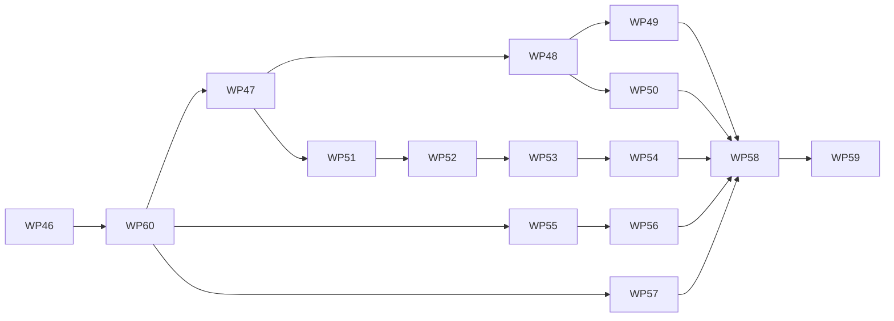

# Cleanup plan: simpler abstractions and current documentation

This plan covers a cleanup round over the whole repository, from the Rust core to the
frontend, followed by a documentation restructure. It is written so that an orchestrator
can hand each work package (WP 46 to 60) to one session, in the same way as the earlier
work packages in [`README.md`](README.md).

The cleanup changes structure and leaves behavior alone. Engine results, search results,
the HTTP API and the stored JSON stay the same unless a work package names the change and
a decision below approves it.

## Where the code stands

The survey read the Rust search and its bindings, the Python agents, the match and
gauntlet code, the tuning scripts, the API and the main frontend hooks in full. The Rust
engine core, vision, synthetic data and most frontend components were read as outlines
only, so their work packages start with a review step instead of a fixed change list.

Most of the mess comes from two sources. The first is the Rust port (WP 42 to 45), which
kept the Python layer intact and left several things defined on both sides. The second is
the strength round (WP 28 and 30), which added params, a champion ratchet and scripts
quickly and in a looser style than the rest of the code.

| # | Finding | Where |
|---|---|---|
| F1 | The 31 agent params of the search are listed by hand about a dozen times: twice in the core structs, four times in the binding constructor, in the stub, and five times in `SearchAgent` (attributes, signature, `Args:`, assignments, the `Searcher` call). Validation is written in Python and again in the binding. | `rust/core/src/agents/{search,evaluation}.rs`, `rust/python/src/search.rs`, `src/hive/_core.pyi`, `src/hive/agents/search.py` |
| F2 | `Searcher` is one struct of 17 fields that mixes config, per-decision buffers, move ordering memory, repetition memory and the helper thread index. `search.rs` is 1,007 lines, `negamax` is 125 lines and `think_serial` holds the aspiration loop inline. | `rust/core/src/agents/search.rs` |
| F3 | Comments still describe the Rust code as a port of Python agents that no longer exist, and piece values are defined twice (`PIECE_VALUES`, `PIECE_VALUE_COUNTS`). | `rust/core/src/agents/` |
| F4 | The Python `GameState` and `Rules` keep the full API of the old Python engine. Many methods have no caller in `src/` and exist for the tests only (`apply_placement`, `undo_movement`, `get_articulation_points`, `placement_moves` and others); `queen_coords`, `validate_ply`, `state_from_board` and `perft_bulk` showed no caller at all in a first grep. `PyMove` and `PyRules` repeat the same pickling, freezing and JSON methods. | `rust/python/src/{state,rules,moves}.rs`, `src/hive/_core.pyi` |
| F5 | The factory derives param schemas by inspecting constructor signatures and parsing docstrings with a regex. `factory.py` holds the registry, `AgentSpec` with five constructors, presets, YAML loading and error formatting in 537 lines, and behavior sits in module functions (`build_agent`, `list_agents`, `list_presets`) next to the types that own the data. | `src/hive/agents/factory.py` |
| F6 | `MinimaxAgent` and `NegamaxAgent` differ by one class constant. Minimax supports none of the search refinements and serves as the reference for the parity tests. | `src/hive/agents/`, `rust/core/src/agents/search.rs` |
| F7 | The promoted champion is not available in the app. It lives in `configs/evaluation/champion.json`, while the shipped presets are `nm2`, `nm3` and `nm-smp`. The manifest stores an absolute home directory path as evidence. | `configs/evaluation/`, `src/hive/agents/presets/` |
| F8 | A match is described by overlapping objects. `MatchRunner` and `MatchResult` both hold rules, both specs, seed, budget and opening, and the runner copies them by hand. `GauntletConfig.match_runner` picks the opening with inline index arithmetic that `ScheduledMatch` could carry. | `src/hive/match/{runner,records,gauntlet}.py` |
| F9 | `gauntlet.py` (747 lines) holds statistics, scheduling, running and five report types. `champion.py` builds openings inside `ChampionTrial.config`, imports lazily to avoid a cycle, and scores reports with static methods instead of a constructor on `ChampionAssessment`. | `src/hive/match/` |
| F10 | Promotion logic (manifest, archive, staleness check, hashing) lives in an untested argparse script, while every other tool is a `hive` Typer command. `tune_search.py` plays games in process with its own loop and predates the ratchet. `bench_search.py` overlaps `SearchBenchCase`. Three places generate random openings. | `scripts/tune_champion.py`, `scripts/tune_search.py`, `scripts/bench_search.py` |
| F11 | `AgentWorker` tracks `process`, `conn` and `stop_event` as three optionals that are checked or asserted in every method, and repeats the grace period loop in `reset` and `wait_until_returned`. | `src/hive/match/worker.py` |
| F12 | `cli.py` is 1,213 lines with six command groups and formatting helpers that belong to the types they describe. `bench.py` mixes the perft correctness harness with the engine benchmark. `LocalTurnContext` lives in `agents/testing.py` but is used by `bench.py` and the scripts. | `src/hive/cli.py`, `src/hive/bench.py`, `src/hive/agents/testing.py` |
| F13 | `errors.py` spends 468 lines on 17 error classes whose constructors store attributes that nothing seems to read. The expected ply check is written four times in `GameService`, and `ThinkingPlan.load` calls check methods on the service that only read the game row. | `src/hive/api/{errors,games,thinking}.py` |
| F14 | `useHint` and `useAgentTurns` each run the thinking stream with their own abort and error handling. Hooks live in `components/`. `lib/players.ts` mixes agent drafts, descriptions, scenarios and next actions, and `NewGameDialog.tsx` is 478 lines. Limits such as `DEFAULT_AGENT_BUDGET_S` are copied by hand from the backend. | `frontend/src/` |
| F15 | The board is drawn by five implementations (matplotlib, SVG, OpenCV in `vision/sequences.py`, `scripts/rules_diagrams.py`, the frontend). `hive.plotting.matplotlib` has no caller. | `src/hive/plotting/`, `src/hive/vision/sequences.py` |
| F16 | `reports/` holds 68 MB in 164 tracked files, including early `wp28-*` reports at the top level. `configs/evaluation/` repeats candidate lists that each report folder already stores in `plan.json`. | `reports/`, `configs/evaluation/` |
| F17 | The documentation is the original plan with results appended. Design, measurement logs, status and roadmap share the same pages, headings carry WP numbers, `engine.md` still has a section on the state before M1, and the root README calls the web app planned. Several issues of merged work packages are still open (for example #28, #34, #35, #39 and #55). | `docs/plans/`, `README.md`, GitHub issues |

The match worker protocol, the API pool and thinking stream, the engine JSON forms
(`engine/forms.py`) and the hand-written stub with its sync test were also reviewed. They
are more involved than the rest, but each solves a real constraint, and the plan leaves
their design as it is.

## Target shape

The cleanup follows three rules that the project already states and the recent code
drifted from.

1. **One definition per value.** A param, a match setting or a limit is declared once per
   language, and everything else reads that declaration.
2. **Behavior on the owning type.** Module functions and static methods that only read one
   object become methods or constructors of that object.
3. **One responsibility per module.** A file that needs a table of contents is split along
   the types it holds.

### Agent params

Each agent class declares a params model instead of spelling its params in the
constructor. The factory reads that model, which removes signature inspection and
docstring parsing.

```python
class SearchParams(AgentParams):          # frozen pydantic model, extra="forbid"
    depth: int | None = Field(None, ge=1, description="The maximum search depth ...")
    queen_safety: float = Field(1.0, allow_inf_nan=False, description="...")
    ...

@register_agent("negamax")
class NegamaxAgent(SearchAgent):          # Agent.__init__(rules, *, seed, params)
    ...
```

The JSON of an `AgentSpec` stays flat and unchanged, so stored games, presets and reports
keep working, and the `params_schema` served to the frontend stays the same apart from
ordering. The Rust `Searcher` takes the validated params as one mapping and fills
`SearchConfig` from it, so the binding no longer lists them. The recommended mechanism is
`serde` on the core structs behind a cargo feature with `pythonize` in the binding crate.
The session confirms this against the current crate documentation before committing to it,
and falls back to a small declarative macro in the core if it does not fit. Range checks
move to one `SearchConfig::validate` in the core. A test asserts that the fields of
`SearchParams` and of the Rust config are the same set, in the manner of
`tests/test_core_stub.py`.

After this, adding an evaluation term touches the core struct, the term itself and one
line in `SearchParams`.

### Search kernel

`rust/core/src/agents/search.rs` becomes a module folder. `Searcher` keeps the iterative
deepening and owns four parts that each hold their own state.

| Module | Holds |
|---|---|
| `search/mod.rs` | `Searcher`, `think`, the depth loop and a separate aspiration step |
| `search/config.rs` | `SearchConfig`, `SearchAlgorithm`, validation |
| `search/negamax.rs`, `search/minimax.rs` | The two tree searches, with table probing and child construction as helpers |
| `search/ordering.rs` | `MoveOrdering`: killers, history, the previous line and the sort scratch |
| `search/repetition.rs` | `RepetitionHistory`: the line path, the game path and its filter |
| `search/parallel.rs` | Helper threads, `HelperObserver`, `SearchCancellation` |
| `search/report.rs` | `DepthReport`, `SearchObserver` |

### Match values

```
MatchConfig      rules, white, black, budget_s, max_turns, seed, opening, grace_s   .run()
MatchResult      config, decisions, outcome, winner, duration_s
GauntletConfig   participants, games_per_pair, ..., openings      .schedule() -> [MatchConfig]
OpeningSet       seeded random openings, used by trials, gauntlets and benchmarks
```

`MatchRunner` and `ScheduledMatch` disappear. `MatchConfig.run` plays the match, as
`GauntletConfig.run` already plays the gauntlet. This nests the config inside the result,
which changes the report JSON (see decision Q3).

`match/` then holds `turn.py`, `worker.py`, `match.py` (config, result, decision record),
`openings.py`, `gauntlet.py` (config and running), `report.py` (the report types),
`statistics.py` (Wilson, Elo, nearest rank, Hoeffding and normal bounds) and
`champion.py` (`ChampionTrial`, `ChampionAssessment.from_report`, `ChampionManifest`).

### Package layout after the cleanup

```
src/hive/
  agents/   base.py, params.py, spec.py, registry.py, presets.py, local.py, search.py, random.py
  match/    turn.py, worker.py, match.py, openings.py, gauntlet.py, report.py, statistics.py, champion.py
  bench/    perft.py, engine.py
  cli/      __init__.py, play.py, champion.py, serve.py, bench.py, data.py, vision.py
  api/      unchanged layout, smaller errors.py and games.py
```

## Decisions for the owner

All nine questions were answered on 2026-11-14, so no work package waits for a decision.

| # | Question | Answer | Blocks |
|---|---|---|---|
| Q1 | Revise D23 so that param schemas come from a declared params model instead of the constructor signature? | **Decided, yes.** | 47, 48 |
| Q2 | Keep `minimax` as an agent kind in the app? | **Decided.** Keep the minimax search in the core as the parity reference, and remove the registered kind and its class. The local development database may hold games that name it. | 51 |
| Q3 | Nest `MatchConfig` in `MatchResult` and move the gauntlet report to version 3? | **Decided, yes.** Reports written before the change no longer load with `hive replay` and are read at the commit that wrote them. | 52, 53 |
| Q4 | Make the champion a shipped preset? | **Decided, yes.** Promotion writes `presets/champion.yaml`, and the provenance of each generation lives with the results (see Q6). | 51, 53 |
| Q5 | How far to trim the Python API of the Rust classes? | **Decided: as far as it simplifies.** The Python API keeps what `src/` calls plus the few methods the differential tests against the oracle cannot do without. Everything else is removed, and its tests move (see WP 50). | 50 |
| Q6 | Where do reports and trial inputs live? | **Decided.** They follow the documentation layout: the evidence a results page cites lives next to that page under `docs/results/`, and raw per-game reports leave git (see below). | 57, 58 |
| Q7 | Delete `hive.plotting.matplotlib` and drop matplotlib from the `plotting` extra? | **Decided, yes.** | 57 |
| Q8 | Move the documentation from plan pages to reference pages as proposed below, and point `CLAUDE.md` at the new entry page? | **Decided, yes.** | 58, 59 |
| Q9 | Spelling? | **Decided.** US spelling everywhere: documentation, comments, docstrings, identifiers, test names, UI text and messages (WP 60). | 60 |

### Reports and trial inputs (Q6)

The answer to Q6 was to bring the reports in line with the documentation layout. This plan
reads that as follows, and the owner should correct it in WP 57 if it was meant
differently.

```
docs/results/
  evaluation.md                       the generations log, citing the folders below
  evaluation/
    generations/generation-N.json     the manifest of each promoted champion (from configs/evaluation/history/)
    <trial>/plan.json, summary.json   inputs and assessment of each screening and confirmation trial
  performance.md                      the speed log
  performance/                        the small benchmark outputs the log cites (from reports/evaluation/speed/)
```

Raw per-game reports (`candidate-*.json.gz`, the `wp28-*` reports and the `nm2-vs-nm3`
files) leave git. They stay in the ignored `data/reports/` folder and go to Garage once
the deployment exists, and each `summary.json` names the file and its SHA-256 so a report
can be matched to its summary. The candidate lists in `configs/evaluation/` are deleted,
because every `plan.json` already holds them, and `configs/` disappears. New trials write
to the same places, which WP 53 and WP 54 build into `ChampionManifest` and
`hive champion`.

## Work packages

Every work package is one branch and one pull request, follows the session workflow of the
README, and keeps `make check test` green. The gates column names what must hold beyond
that. "Parity" means the existing correctness gates of `rust-core.md`: perft counts, the
differential tests against the oracle, and equal node counts and scores in
`rust/core/tests/search.rs` and `tests/agents/test_search.py`.

| WP | Title | Depends on | Gates | Issue |
|---|---|---|---|---|
| 46 | Baseline, pinned formats and issue housekeeping | – | – | #93 |
| 60 | US spelling everywhere | 46 | Parity, OpenAPI diff is descriptions only | #107 |
| 47 | Declared agent params models | 60 | Stored specs load, `params_schema` equal up to order | #94 |
| 48 | Search params cross the binding as one mapping | 47 | Parity, speed within noise | #95 |
| 49 | Split the search kernel by responsibility | 48 | Parity, speed within noise | #96 |
| 50 | Binding surface and engine core review | 48 | Parity, stub test | #97 |
| 51 | Agents package: spec, registry, presets | 47 | OpenAPI diff reviewed | #98 |
| 52 | Match values: `MatchConfig`, openings, worker handle | 51 | Seeded match reproduces the pinned result | #99 |
| 53 | Gauntlet report, statistics and champion trials | 52 | Pinned assessment numbers reproduce | #100 |
| 54 | CLI package, bench package and retired scripts | 53 | CLI help text snapshot | #101 |
| 55 | API errors and game checks | 60 | OpenAPI schema unchanged | #102 |
| 56 | Frontend: thinking stream, hooks and module splits | 55 | Vitest, no visual change | #103 |
| 57 | Vision, data, plotting and repository hygiene | 60 | – | #104 |
| 58 | Documentation restructure | 49 to 57 | Docs checker clean | #105 |
| 59 | README, `CLAUDE.md`, guides and docstring pass | 58 | Docs checker clean | #106 |



WP 60 touches about a hundred files across every area, so it runs alone, directly after
the baseline and before the lanes fan out. Four lanes can run in parallel after WP 47:
Rust (48, 49, 50), Python match (51 to 54),
app (55, 56) and hygiene (57). WP 48 and WP 51 both touch `agents/search.py` and the
factory, so WP 51 rebases on WP 48 if they overlap. The documentation packages run last
because every earlier package moves the things they describe.

### WP 46: Baseline, pinned formats and issue housekeeping

The later packages need fixed points to compare against, and none exist for the wire
formats today.

- Record `make perft`, `hive bench engine` and the fixed-suite search depth and nodes per
  second for the champion on the current `main`, in a short table at the end of this file.
- Add golden fixtures with tests: one gauntlet report with replays, the champion spec, a
  `players` JSON value as stored in the database, and the output of `hive openapi`.
- Add a pinned seeded match (two depth-limited agents, fixed seed) whose moves and outcome
  a test compares, so match refactors cannot change play.
- Compare the open issues with the merged work and close or update the finished ones (#28,
  #34, #35, #39 and #55 look merged).

Done when the fixtures are in `tests/data/`, their tests pass, and the decisions table has
answers.

### WP 60: US spelling everywhere

The repository mixes British and US spelling. A first search found about 530 lines in
about 100 files (163 in `src/`, 96 in `frontend/src/`, 73 in `blender/`, 110 in `docs/`,
42 in the Rust crates, the rest in tests and scripts). Few identifiers are affected, among
them `ColourChoice`, `centre_x`, `centre_y`, `centre_distance`, `startCentre` and a
handful of test names. No stored field name or API field name was found with British
spelling, so no migration and no report change is expected, and the session confirms that
before renaming anything that is serialized.

- Convert prose, comments, docstrings, identifiers, test names, UI text, log messages and
  error messages to US spelling (`color`, `neighbor`, `behavior`, `center`, `favor`,
  `-ize`, `canceled`, `labeled`, `gray`). `cancellation` is already US spelling.
- Engine error messages are compared with the frozen oracle in the differential tests.
  Where a message changes, change it in the Rust core and in `tests/oracle/` together.
  This is the only edit the oracle receives.
- Leave external names alone: asset ids such as `large_grey_tiles`, quoted titles, URLs
  and the contents of tracked reports.
- Regenerate what is derived: `make api-client`, the scene schema (`hive data schema`),
  the rules diagrams and `_core.pyi` together with the binding doc comments.
- Add a spelling check to `make lint` and CI so the rule holds afterwards. `codespell`
  with its British to US dictionary is the standard tool to try first, with an ignore list
  for the external names. State the rule in `CLAUDE.md` and `tooling.md`.

Done when the check passes on the whole repository, parity holds, and the OpenAPI diff
shows changed descriptions only.

### WP 47: Declared agent params models

- Add `agents/params.py` with the `AgentParams` base model, and `SearchParams` with every
  constraint and description that `SearchAgent.__init__` and its docstring hold today.
- Change `Agent.__init__` to `(rules, *, seed, params)`, generic over the params model.
  `AgentRegistration.from_class` reads `agent_class.Params`. Remove
  `parse_arg_descriptions`, `DOCSTRING_ARG_PATTERN` and the signature checks.
- `SearchAgent` keeps `params` and passes `params.model_dump()` to `Searcher` as keywords
  for now. The test agents in `match/testing.py` get small params models.
- Update `agents-and-matches.md` §Factory and D23.

Done when `SearchAgent` lists no param by name, the golden spec and presets validate, and
the `params_schema` of every kind equals the old one up to property order.

### WP 48: Search params cross the binding as one mapping

- Give `SearchConfig` and `EvaluationWeights` derived defaults and a single
  `SearchConfig::validate`. Remove `SearchConfig::new` or reduce it to the three-argument
  convenience the tests use.
- `PySearcher::new(rules, algorithm, params)` converts the mapping into the config and
  drops the 34-argument signature, both `#[expect]` attributes and the hand-written checks.
- Update `_core.pyi` and add the field-set sync test.
- Remove `STOP_CHECK_INTERVAL` from the agent if nothing else sets it, or make it a
  documented param.

Done when the params appear once in the core and once in `SearchParams`, parity holds, and
a search of the baseline suite is within noise of WP 46.

### WP 49: Split the search kernel by responsibility

- Move `search.rs` to the module folder of the target shape. Extract `MoveOrdering` and
  `RepetitionHistory` with their state, the aspiration step out of `think_serial`, and
  table probing and child construction out of `negamax`.
- Merge `PIECE_VALUES` and `PIECE_VALUE_COUNTS`. Reword the comments that refer to Python
  agents so they state the contract itself (move order at the root, summation order).
- Update `rust-core.md` §Search kernel.

Helper threads clone the searcher, so the split must keep that clone cheap. Compare nodes
per second with WP 46 on one and two threads before merging. Done when no function in the
kernel exceeds about 60 lines, parity holds and speed is within noise.

### WP 50: Binding surface and engine core review

- List every method of `PyGameState`, `PyRules` and `PyMove` with its callers in `src/`,
  the tests, the scripts and the oracle tests, and put the table in the pull request.
- Remove every method that `src/` does not call, unless the differential tests need it to
  compare the core with the oracle (Q5). The old mutation API (`apply_placement`,
  `undo_placement`, `apply_movement`, `undo_movement`) and the connectivity queries are
  the main candidates. Update the stub with each removal.
- Tests that only exercised a removed method are rewritten on the remaining API
  (`apply_checked_move`, `legal_moves`) or moved to Rust unit tests next to the code they
  cover. A test is deleted only when a Rust test or a differential test already asserts
  the same behavior, and the pull request lists each such case.
- Share the pickling, freezing and JSON methods of `PyMove` and `PyRules` through one
  helper in `values.rs` or `json.rs`.
- Review the engine core (`rules.rs`, `state.rs`, `board.rs`, `movement.rs`) against the
  three rules of the target shape. The survey did not read these files in full, so this
  step reports what it finds in the pull request and changes only what is clearly simpler.

Done when every remaining binding method has a caller in `src/` or in the differential
tests, the stub test passes and test coverage of the engine did not drop.

### WP 51: Agents package

- Split `factory.py` into `spec.py` (`AgentSpec`, `InvalidAgentSpecError`, error
  formatting), `registry.py` (`AgentRegistration`, `register_agent`, the registry) and
  `presets.py` (`AgentPreset`).
- Move behavior to the owning types: `AgentSpec.build(rules, seed=)` replaces
  `build_agent`, and `AgentRegistration.all()` and `AgentPreset.names()` replace
  `list_agents` and `list_presets`. Reduce the five `AgentSpec` constructors where two do
  the same job (`load` and `from_yaml`, `from_preset` and `resolve`).
- Move `LocalTurnContext` to `agents/local.py`. `FakeClock` and `TurnSubmission` stay in
  `testing.py`.
- Remove the `minimax` kind and class (Q2), keeping the search in the core for the
  parity tests. Add the champion as the preset `champion` (Q4) and make it the default
  choice of the new game flow. Decide in the session whether `nm-smp` still has a use.

Done when `factory.py` is gone, the agent routes return the same kinds and presets apart
from the approved changes, and `make api-client` shows only those.

### WP 52: Match values

- Introduce `MatchConfig` and `OpeningSet`, nest the config in `MatchResult`, and move the
  loop of `MatchRunner.run` to `MatchConfig.run`. `GauntletConfig.schedule` returns match
  configs with their opening, which removes `ScheduledMatch` and the index arithmetic.
- In `AgentWorker`, group `process`, `conn` and `stop_event` into one handle that is
  either present or `None`, and share one "receive until the grace deadline" helper
  between `reset`, `wait_until_returned` and `CandidateSelection.collect`.
- Apply Q3 to the report version, and update the API pool and `thinking.py` only where
  names change.

Done when the pinned seeded match reproduces move for move and the worker tests pass
without changes to what they assert.

### WP 53: Gauntlet report, statistics and champion trials

- Split `gauntlet.py` into `gauntlet.py`, `report.py` and `statistics.py`. Move the
  Hoeffding and normal bounds from `champion.py` to `statistics.py`.
- `ChampionAssessment.from_report(report, gate, alpha)` replaces the two static methods
  and becomes a `JsonCodec` value like the other records. `ChampionTrial.config` only
  validates and assembles, using `OpeningSet`.
- Add `ChampionManifest` with `load` and `promote`, holding the logic that
  `tune_champion.py` runs inline today (archive the old generation, refuse a stale or
  dirty promotion, write evidence as a repository-relative path), with tests. It writes
  the champion preset and the generation manifest to the places Q4 and Q6 name.

Done when recomputing the assessment of a committed confirmation report gives the numbers
in its `summary.json`, and promotion is covered by tests on a temporary directory.

### WP 54: CLI package, bench package and retired scripts

- Split `cli.py` into the `cli/` package, one module per command group, and
  `tests/test_cli.py` to match. Move `log_decision`, `describe_match_result`,
  `format_move` and the board writers onto `DecisionRecord`, `MatchResult` and the
  plotting module.
- Add `hive champion trial` and `hive champion promote` on top of WP 53, and
  `hive bench search` for what `bench_search.py` measures. Delete `tune_champion.py`,
  `tune_search.py` and `bench_search.py`, and update `evaluation.md` §Commands.
- Split `bench.py` into `bench/perft.py` and `bench/engine.py`. Decide in the session
  whether `EngineBenchCase` and its three subclasses are simpler as one dataclass with a
  measuring callable.

Done when `scripts/` holds only `train/`, `tooling/`, `rules_diagrams.py` and
`fetch_render_assets.py`, and the help text of every command is unchanged apart from the
additions.

### WP 55: API errors and game checks

- Reduce each `ApiError` subclass to its status, code, description and message. Drop the
  stored attributes after confirming nothing reads them, and consider deriving
  `ApiErrorCode` from the classes so the two lists cannot drift.
- Move `check_active`, `check_no_pending_move` and the expected ply check to `GameRow`,
  which owns the data they read. `GameService` and `ThinkingPlan.load` call the row.
- Leave `players.py` as it is. Merging `HintAgent` and `AgentPlayer` into one timed agent
  value was considered and rejected, because it changes stored JSON and the API for a
  saving of two fields.

Done when the `hive openapi` output equals the golden file and the API tests pass
unchanged.

### WP 56: Frontend

- Extract the shared part of `useHint` and `useAgentTurns` into one function or hook that
  runs `streamThinkEvents` with abort and error handling and reports events. Both hooks
  keep their own policy and state.
- Move hooks to `src/hooks/`. Split `lib/players.ts` into agent drafts, scenarios and
  player descriptions, and `NewGameDialog.tsx` into one component per step.
- Read `DEFAULT_AGENT_BUDGET_S` and the name length limits from the generated schema or
  add a test that compares them with it.
- Review `SvgBoard.tsx` and `marks.tsx` for parts the 2.5D renderer of WP 39 will share,
  and move those to renderer-neutral modules. Update `frontend.md` §Structure.

Done when the existing component and page tests pass with import changes only.

### WP 57: Vision, data, plotting and repository hygiene

- Review `vision/` and `data/` against the target rules and report first. Likely changes
  are splitting `scenes.py` into scene values and the sampler, and moving frame drawing
  out of `sequences.py` and `cli.py` into one module.
- Delete `hive.plotting.matplotlib` and drop matplotlib from the `plotting` extra (Q7).
- Move reports and trial inputs as described under Q6: summaries, plans and generation
  manifests to `docs/results/`, raw reports out of git with their hashes recorded, and
  `configs/evaluation/` deleted. Fix the paths that `evaluation.md` and `performance.md`
  cite in the same change.
- Add the photo and vision status to the API page notes for WP 58: the photo table and
  storage exist, and no route or reader is connected yet.

Done when the review is in the pull request, the approved removals are made, and
`.gitignore` covers what moved out.

### WP 58: Documentation restructure

This package follows the `write-docs` skill and writes in the voice of the
`writing-style` skill. The `write-docs` skill was written for another repository, so the
session first adapts its checker script and page patterns to this one (paths, `make check`
instead of `make ci`). Its proposal gate is answered by Q8 and the layout below, and the
session still presents headers per page for approval before writing.

The current pages mix four kinds of content. The restructure gives each kind one home.

```
README.md              what the project is, how to run it, where to read more
CLAUDE.md              commands, hard rules, where to find things, keep-docs-current rule
docs/
  architecture.md      system overview, package map, dependency direction, decisions D1 to D33
  engine.md            rules model, Rust core, representation, Python API contract, perft, gates
  agents.md            agent interface, params models, registry, presets, search and evaluation reference
  matches.md           turn protocol, workers, matches, gauntlets, report format, champion ratchet
  api.md               service, schema, endpoints, pool, streaming, observability, what is not connected
  frontend.md          structure, board rendering, theme, flows, help
  vision.md            pipeline, readers, status and limitations
  synthetic-data.md    scenes, tilesets, renderer, datasets, training
  development.md       setup, commands, style rules, hooks, CI, git workflow (from tooling.md)
  deployment.md        the planned deployment, marked as not built
  results/
    performance.md     engine and search speed measurements, as a dated log
    evaluation.md      champion generations, as a dated log
    evaluation/        generation manifests and the plan and summary of each trial (Q6)
    performance/       the benchmark outputs the speed log cites
  plans/
    README.md          roadmap: milestones, open work packages, manual tasks, future work
    cleanup.md         this plan, until it is done
```

- Write each reference page from the source after the code packages have merged, in
  present tense and without WP numbers in headings. Decisions keep their numbers and move
  to `architecture.md`, with D23 and the others revised by this plan updated.
- Move measurement tables and trial narratives to `results/` without rewriting their
  numbers. Remove obsolete sections such as "Current state (before M1)".
- Give `rust/core/src/lib.rs` and each module a crate-level overview that matches the
  reference pages, and check that `make lint-rust` builds the rustdoc cleanly.
- Run the docs checker for every moved or removed file, and update the references in
  `CLAUDE.md`, source comments, issue templates and the agent memory.

Done when no page describes planned work as existing or existing work as planned, and the
checker reports no broken link or path.

### WP 59: README, `CLAUDE.md`, guides and docstring pass

- Rewrite the root README: what Hive is in two sentences, what the app does today, a
  screenshot, the shortest route to a running game (`make sync`, `make dev`), and a map of
  the documentation.
- Reduce `CLAUDE.md` to an entry point that names `docs/architecture.md` as the first
  read, keeps the commands and the hard style rules, and links to `development.md` for the
  rest.
- Add three guides under `docs/guides/` for the tasks that recur: adding an evaluation
  term or search option, running a screening and a confirmation trial through promotion,
  and adding an agent kind. Run every command a guide names.
- Read module and class docstrings in the packages touched by WP 47 to 57 and fix the ones
  the moves made stale. The checkers already enforce their form, so this pass is about
  content.

Done when a new session can find the right page for any package from `CLAUDE.md` in one
step, and every guide command was executed.

## Notes for orchestration

- Start each session with "Implement issue #N". The issue repeats the section above as
  the session prompt, and the findings table gives the reasons.
- A session that finds a planned change does not simplify the code says so in the pull
  request and skips it. The plan lists intentions from a survey, and the code wins.
- No package deletes a test without a replacement that asserts the same behavior. Tests
  change only where names or module paths change, except in WP 50.
- Every package updates the passages of `docs/plans/` it invalidates, as the session
  workflow already requires. WP 58 then moves text that is already correct.
- Packages 48 and 49 report nodes per second before and after in the pull request. A
  slowdown beyond run-to-run noise blocks the merge.
- The feature work that is still open (WP 16, 19, 20, 25, 26, 29, 39 to 41) is easier
  after WP 52, 55 and 56. If feature work continues in parallel, it should avoid `match/`,
  `agents/` and `cli.py` until WP 54 has merged.

## Baseline

WP 46 fills this section with the benchmark numbers of `main` before the cleanup.
